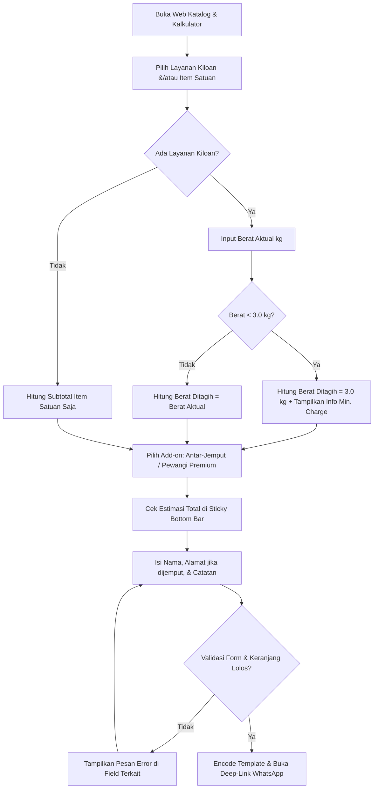

# Product Requirements Document — LaundryCalc & Catalog

**Document Version:** 1.0  
**Application Version:** MVP (v0.1)  
**Status:** Draft  
**Last Updated:** 18 November 2026

---

## 1. Document Information

| Attribute | Details |
| :--- | :--- |
| **Product Name** | LaundryCalc & Catalog |
| **Product Type** | Mobile-First Responsive Web Application (Tanpa Login / Akun) |
| **Primary Platform** | Mobile Web Browser (Chrome, Safari) & Desktop |
| **Target MVP Version** | v0.1 (Katalog Kiloan & Satuan, Kalkulator Estimasi + Minimum Charge, WhatsApp Order Generator) |
| **PRD Status** | Ready for Implementation |

---

## 2. Problem Background

* **Core Problem:** Calon pelanggan sering ragu memesan karena tidak mengetahui rincian tarif (termasuk ketentuan berat minimal dan biaya layanan satuan/tambahan), sementara admin laundry menghabiskan waktu membalas pertanyaan harga berulang dengan format pesanan yang tidak seragam.
* **Affected Persona:** Pelanggan laundry (rumah tangga, mahasiswa/kost, pekerja) dan Admin Operasional Toko Laundry.
* **Current Manual Workarounds:** Pelanggan menghubungi WhatsApp toko untuk menanyakan daftar harga per kg atau per item, menghitung secara manual, lalu mengetik detail pesanan tanpa format baku.
* **Consequences of Inaction:** Waktu respons admin melambat saat jam sibuk, konversi calon pelanggan menurun, dan muncul potensi komplain atau salah paham saat berat timbangan aktual berada di bawah batas minimal (3 kg).

---

## 3. Product Goals & Success Indicators

| Goal ID | Objective | Success Indicator | Target | Measurement Method |
| :--- | :--- | :--- | :--- | :--- |
| **GL-01** | Mengurangi beban chat tanya-jawab tarif dasar | Penurunan pesan masuk kategori pertanyaan harga katalog | Turun $\ge 40\%$ | Rekap log chat WhatsApp admin mingguan |
| **GL-02** | Mempercepat konversi pesanan masuk | Pesanan masuk melalui template terstruktur dari aplikasi | $\ge 75\%$ dari total order via WhatsApp | Audit chat pesanan masuk harian |
| **GL-03** | Transparansi aturan berat minimal dan rincian tarif | Penurunan selisih paham atau komplain terkait *minimum charge* | Komplain tarif $< 2\%$ | Catatan komplain kasir/admin bulanan |

---

## 4. Target Users & Roles

* **Pelanggan (Customer — Primary User):** Mengakses tautan katalog dari bio media sosial, Google Business Profile, atau status WhatsApp. Membutuhkan tampilan daftar paket yang jelas, simulasi biaya cepat untuk campuran cucian kiloan dan satuan, serta tombol pengiriman pesanan langsung ke WhatsApp.
* **Admin Laundry (Secondary User):** Menerima pesan WhatsApp berformat baku yang memuat identitas pemesan, rincian paket kiloan, daftar item satuan, layanan tambahan, alamat jemput, dan total estimasi awal.
* **Pemilik Toko (Maintainer):** Memperbarui daftar harga, durasi pengerjaan, dan nomor WhatsApp tujuan melalui file konfigurasi statis (`config.json` / modul konstanta).

---

## 5. Business Logic & Rules

*(Catatan: Angka tarif dan batas minimal menggunakan `[Proposed Assumption]` berdasarkan standar operasional laundry UMKM dan dapat disesuaikan di file konfigurasi).*

### BL-01: Perhitungan Berat Ditagih (*Minimum Charge Rule*)
* **Trigger:** Pengguna memilih paket layanan kiloan dan memasukkan estimasi berat cucian ($W_{\text{aktual}}$ dalam satuan kg).
* **Input:** $W_{\text{aktual}}$ (Float $\ge 0.1$, kelipatan $0.1\text{ kg}$). Jika pengguna hanya memesan layanan satuan tanpa paket kiloan, maka $W_{\text{aktual}} = 0$ dan $W_{\text{ditagih}} = 0$.
* **Formula:**
  $$W_{\text{ditagih}} = \begin{cases} \max(3.0, W_{\text{aktual}}) & \text{jika } W_{\text{aktual}} > 0 \\ 0 & \text{jika } W_{\text{aktual}} = 0 \end{cases}$$
* **Expected Output:** Nilai $W_{\text{ditagih}}$ yang menjadi pengali tarif paket kiloan dan add-on berbasis berat.
* **Constraints & Exceptions:** Input negatif ditolak. Jika $0 < W_{\text{aktual}} < 3.0$, sistem wajib menampilkan indikator bahwa tarif dihitung berdasarkan batas minimal $3.0\text{ kg}$.

### BL-02: Kalkulasi Subtotal Layanan Kiloan, Satuan, dan Add-on
* **Trigger:** Pengguna mengubah pilihan paket kiloan, berat cucian, kuantitas item satuan, atau opsi *add-on*.
* **Referensi Katalog `[Proposed Assumption]`:**
  * **Paket Kiloan (Pilih maks. 1 paket utama per transaksi):**
    * `K01` Cuci Lipat Reguler: Rp 6.000/kg (Estimasi 3 hari)
    * `K02` Cuci Setrika Reguler: Rp 8.000/kg (Estimasi 3 hari)
    * `K03` Cuci Setrika Ekspres: Rp 15.000/kg (Estimasi 1 hari)
  * **Layanan Satuan (Bisa pilih banyak item & atur jumlah):**
    * `S01` Bedcover Besar (King/Queen): Rp 25.000/pcs (Estimasi 3 hari)
    * `S02` Selimut / Sprei Set: Rp 15.000/pcs (Estimasi 3 hari)
    * `S03` Sepatu / Tas Ransel: Rp 30.000/pcs (Estimasi 3 hari)
  * **Layanan Tambahan (*Add-on*):**
    * `A01` Antar-Jemput: Rp 10.000 (Flat per pesanan, maks. radius 5 km)
    * `A02` Pewangi Premium: Rp 2.000/kg (Dikalikan $W_{\text{ditagih}}$; hanya aktif jika ada pesanan kiloan)
* **Formula:**
  $$\text{Subtotal}_{\text{kiloan}} = W_{\text{ditagih}} \times \text{Tarif}_{\text{kiloan}}$$
  $$\text{Subtotal}_{\text{satuan}} = \sum_{i=1}^{n} (\text{Qty}_i \times \text{Tarif}_i)$$
  $$\text{Biaya}_{\text{pewangi}} = \text{PewangiAktif} \ ? \ (W_{\text{ditagih}} \times 2000) : 0$$
  $$\text{Biaya}_{\text{antar}} = \text{AntarJemputAktif} \ ? \ 10000 : 0$$
  $$\text{TotalEstimasi} = \text{Subtotal}_{\text{kiloan}} + \text{Subtotal}_{\text{satuan}} + \text{Biaya}_{\text{pewangi}} + \text{Biaya}_{\text{antar}}$$
* **Contoh Perhitungan Numerik:**
  * *Skenario Gabungan:* Pelanggan memilih **Cuci Setrika Reguler** ($1,8\text{ kg}$), **Bedcover Besar** ($1\text{ pcs}$), **Pewangi Premium**, dan **Antar-Jemput**.
  * $W_{\text{ditagih}} = \max(3.0, 1.8) = 3.0\text{ kg}$.
  * $\text{Subtotal}_{\text{kiloan}} = 3.0 \times \text{Rp } 8.000 = \text{Rp } 24.000$.
  * $\text{Subtotal}_{\text{satuan}} = 1 \times \text{Rp } 25.000 = \text{Rp } 25.000$.
  * $\text{Biaya}_{\text{pewangi}} = 3.0 \times \text{Rp } 2.000 = \text{Rp } 6.000$.
  * $\text{Biaya}_{\text{antar}} = \text{Rp } 10.000$.
  * **Total Estimasi:** $\text{Rp } 24.000 + \text{Rp } 25.000 + \text{Rp } 6.000 + \text{Rp } 10.000 = \mathbf{\text{Rp } 65.000}$.

### BL-03: Validasi Checkout & Generator Deep-Link WhatsApp
* **Trigger:** Pengguna menekan tombol **"Kirim Pesanan ke WhatsApp"**.
* **Validasi:**
  1. Keranjang tidak boleh kosong ($\text{TotalEstimasi} > 0$, minimal terdapat layanan kiloan dengan $W_{\text{aktual}} > 0$ atau minimal 1 item satuan dengan $\text{Qty} \ge 1$).
  2. **Nama Pelanggan** wajib diisi (minimal 2 karakter non-spasi).
  3. **Alamat Penjemputan** wajib diisi apabila opsi `A01` (Antar-Jemput) dicentang.
* **Processing:** Menyusun string template pesan berisi rincian item, berat aktual vs. ditagih, subtotal, add-on, data pemesan, dan klausul *disclaimer* timbangan ulang, lalu menerapkan `encodeURIComponent()` untuk membuka tautan `https://wa.me/<NOMOR_WA_TOKO>?text=<PESAN_TERENCODE>`.
* **Expected Output:** Aplikasi WhatsApp atau WhatsApp Web terbuka langsung pada jendela chat toko laundry dengan teks pesanan siap kirim.

---

## 6. Feature Requirements

| Feature Code | Feature Name | Requirement Description | Related Business Logic | Priority | Target Version |
| :--- | :--- | :--- | :--- | :--- | :--- |
| **FT-01** | Katalog Layanan Kiloan & Satuan | Menampilkan tab atau bagian terpisah untuk paket kiloan dan item satuan lengkap dengan harga, durasi pengerjaan, dan deskripsi singkat. | BL-02 | Must Have | v0.1 |
| **FT-02** | Kalkulator Berat & Info Minimum Charge | Input berat (kg) dengan tombol `+/-` atau ketik manual (step `0.1`). Menampilkan badge informasi otomatis jika input $0 < W_{\text{aktual}} < 3.0\text{ kg}$. | BL-01 | Must Have | v0.1 |
| **FT-03** | Pemilih Kuantitas Item Satuan | Kontrol *stepper* (`-` / `+`) pada setiap kartu layanan satuan untuk menambah atau mengurangi jumlah item ke dalam kalkulasi yang sama. | BL-02 | Must Have | v0.1 |
| **FT-04** | Panel Add-on Kondisional | Checkbox/toggle untuk Antar-Jemput dan Pewangi Premium. Opsi Pewangi Premium otomatis nonaktif jika berat kiloan bernilai `0`. | BL-02 | Must Have | v0.1 |
| **FT-05** | Sticky Summary & Rincian Biaya | Bilah ringkasan melayang di bagian bawah layar yang menampilkan total estimasi *real-time* beserta laci (*drawer/modal*) rincian perhitungan. | BL-01, BL-02 | Must Have | v0.1 |
| **FT-06** | Formulir Data Pemesan & Checkout WA | Input Nama Pelanggan, Alamat (muncul dinamis saat Antar-Jemput aktif), Catatan Khusus, serta tombol aksi menuju WhatsApp. | BL-03 | Must Have | v0.1 |
| **FT-07** | Banner Info Operasional Toko | Menampilkan jam buka toko, jadwal penjemputan kurir, dan radius layanan antar-jemput di bagian atas halaman. | - | Should Have | v0.1 |

---

## 7. Main User Flow & WhatsApp Template



### Format Template Pesanan WhatsApp

```text
Halo Admin Laundry, saya ingin memesan layanan dengan rincian estimasi berikut:

*Nama:* [Nama Pelanggan]
*Metode:* [Antar-Jemput / Antar Sendiri ke Toko]
*Alamat:* [Alamat Lengkap atau "-"]

*Rincian Pesanan:*
• Paket Kiloan: [Nama Paket] — Estimasi [X] kg (Ditagih [Y] kg) = Rp [Subtotal Kiloan]
• Layanan Satuan:
  - [Nama Item 1] ([Qty]x) = Rp [Subtotal Item 1]
• Layanan Tambahan:
  - Antar-Jemput: [Ya (Rp 10.000) / Tidak]
  - Pewangi Premium: [Ya (Rp Z.000) / Tidak]

*Catatan:* [Catatan Pelanggan atau "-"]
*Estimasi Total Biaya:* *Rp [Total Estimasi]*

_(Catatan: Nominal di atas merupakan estimasi awal. Berat dan jumlah pasti akan dikonfirmasi kembali setelah penimbangan oleh tim toko)._
```

---

## 8. Acceptance Criteria

| AC ID | Related Feature | Condition | Expected Behavior | Pass Criteria |
| :--- | :--- | :--- | :--- | :--- |
| **AC-01** | FT-01, FT-02 | Pengguna memilih paket Cuci Lipat (Rp 6.000/kg) dan mengisi berat `1.5` kg | Sistem menetapkan berat ditagih `3.0` kg, menampilkan notifikasi minimum charge, dan menghitung subtotal `Rp 18.000`. | Label pemberitahuan min. 3 kg terlihat dan subtotal tepat `Rp 18.000`. |
| **AC-02** | FT-03 | Pengguna tidak memilih paket kiloan, tetapi memilih `2` pcs Bedcover (Rp 25.000/pcs) | Sistem tidak menerapkan minimum charge kiloan dan menghitung subtotal satuan `Rp 50.000`. | Total estimasi menampilkan `Rp 50.000` tanpa biaya kiloan. |
| **AC-03** | FT-04 | Berat kiloan bernilai `0` (hanya order satuan) | Checkbox Pewangi Premium dalam keadaan nonaktif (*disabled*) dengan keterangan khusus cucian kiloan. | Pengguna tidak dapat mencentang Pewangi Premium saat berat kiloan kosong. |
| **AC-04** | FT-05, FT-06 | Pengguna mencentang Antar-Jemput, mengisi Nama, tetapi membiarkan Alamat kosong lalu klik Checkout | Sistem menahan pengalihan ke WhatsApp dan menyorot kolom Alamat dengan pesan wajib diisi. | WhatsApp tidak terbuka dan fokus kursor/pesan error muncul pada input Alamat. |
| **AC-05** | FT-06 | Seluruh data valid terisi dan tombol "Kirim Pesanan ke WhatsApp" ditekan | Browser memicu URL `https://wa.me/...` dengan teks terformat rapi sesuai rincian kalkulator. | Pesan di kolom ketik WhatsApp memuat seluruh item, harga, dan total yang identik dengan aplikasi. |

---

## 9. Validation Test Scenarios

| Test ID | Related Req | Scenario | Test Input | Expected Result | Test Type |
| :--- | :--- | :--- | :--- | :--- | :--- |
| **TC-01** | FT-02, FT-05 | Order kiloan di bawah batas minimal | Cuci Setrika (`1.2` kg), tanpa add-on | Berat ditagih `3.0` kg, Total `Rp 24.000` | Boundary |
| **TC-02** | FT-02, FT-03, FT-04 | Order gabungan kiloan + satuan + seluruh add-on | Cuci Setrika (`4.0` kg) + Sepatu (`1` pcs) + Pewangi + Antar-Jemput | Kiloan `Rp 32.000` + Satuan `Rp 30.000` + Pewangi `Rp 8.000` + Antar `Rp 10.000` = `Rp 80.000` | Happy Path |
| **TC-03** | FT-03, FT-05 | Order khusus layanan satuan saja | Kiloan `0` kg, Selimut (`2` pcs), Antar-Jemput | Satuan `Rp 30.000` + Antar `Rp 10.000` = `Rp 40.000` | Happy Path |
| **TC-04** | FT-06 | Checkout dengan keranjang kosong | Berat `0` kg, semua item satuan `0`, Nama: "Rina" | Tombol checkout nonaktif atau muncul alert pilih minimal 1 layanan | Error |
| **TC-05** | FT-06 | Input catatan mengandung karakter khusus URL (`&`, `#`, baris baru) | Catatan: "Baju putih & batik #2\nTolong pisah" | Karakter ter-encode sempurna tanpa memotong isi pesan di WhatsApp | Boundary |

---

## 10. Constraints & Out of Scope

### Business Constraints
* Semua harga yang ditampilkan bersifat estimasi awal; penentuan tagihan final mengikuti timbangan digital resmi di gerai/kurir.
* Layanan antar-jemput pada versi awal menggunakan tarif flat dengan batas jarak maksimal yang ditentukan toko.

### Technical & Platform Constraints
* Aplikasi harus berjalan ringan tanpa proses login/registrasi dan responsif pada layar smartphone mulai lebar `360px`.
* Membutuhkan dukungan tautan eksternal `wa.me` pada browser perangkat pengguna.

### Explicit Out of Scope (MVP v0.1)
* Halaman Admin Dashboard / CMS berbasis database untuk ubah harga lewat UI.
* Integrasi Payment Gateway (QRIS otomatis, Virtual Account, e-Wallet).
* Pelacakan status pesanan *real-time* (Dicuci, Disetrika, Siap Diambil).
* Perhitungan ongkos kirim otomatis berbasis jarak GPS / Google Maps API.

---

## 11. Data Entities & Storage Requirements

Seluruh master data katalog disimpan dalam file konfigurasi statis terstruktur (misalnya `src/config/laundryCatalog.json`) agar mudah diperbarui tanpa memerlukan server database pada v0.1:

* **`StoreConfig`:** `storeName` (string), `whatsappNumber` (string format `628...`), `operatingHours` (string), `pickupHours` (string), `minChargeKg` (number, default `3.0`), `disclaimerText` (string).
* **`KiloanPackage`:** `id` (string), `name` (string), `pricePerKg` (number), `estimatedDays` (number), `description` (string), `isActive` (boolean).
* **`SatuanItem`:** `id` (string), `name` (string), `unitLabel` (string, mis. `"pcs"` / `"pasang"`), `pricePerUnit` (number), `estimatedDays` (number), `isActive` (boolean).
* **`AddonService`:** `id` (string), `name` (string), `price` (number), `chargeType` (`"flat"` | `"per_billed_kg"`), `requiresKiloan` (boolean), `notes` (string).

---

## 12. Assumptions, Risks & Open Items

* **Assumptions:**
  * `[Proposed Assumption]` Daftar harga paket kiloan, item satuan, add-on, dan batas minimal `3.0 kg` pada Bagian 5 merupakan nilai contoh awal yang akan diganti dengan daftar harga resmi toko Anda sebelum rilis.
  * Pelanggan mengakses aplikasi menggunakan perangkat yang memiliki aplikasi WhatsApp atau WhatsApp Web aktif.
* **Risks & Mitigations:**
  * *Risiko:* Pelanggan memasukkan estimasi berat jauh lebih rendah dari berat asli sehingga terkejut saat penimbangan ulang.  
  * *Mitigasi:* Menyertakan panduan visual ringan (misal: *"10–12 potong kaos dewasa $\approx 2\text{ kg}$"*) dan mencantumkan catatan estimasi secara eksplisit di web maupun di dalam teks WhatsApp.
* **Open Items (Non-Blocking untuk MVP):**
  * Penetapan daftar lengkap seluruh item satuan milik toko Anda (seperti jas, gaun, karpet, boneka) untuk dimasukkan ke file konfigurasi.

---

## 13. Requirement Traceability Matrix

| Business Logic (BL) | Feature Code (FT) | Acceptance Criteria (AC) | Test Case (TC) |
| :--- | :--- | :--- | :--- |
| **BL-01** (Aturan Minimum Charge 3 kg) | FT-02, FT-05 | AC-01 | TC-01 |
| **BL-02** (Kalkulasi Kiloan, Satuan & Add-on) | FT-01, FT-03, FT-04, FT-05 | AC-02, AC-03 | TC-02, TC-03 |
| **BL-03** (Validasi Form & Generator WhatsApp) | FT-06 | AC-04, AC-05 | TC-04, TC-05 |